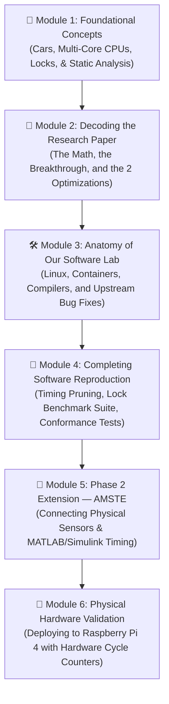
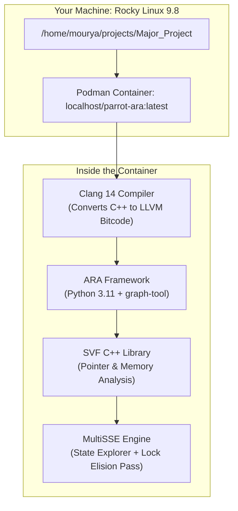
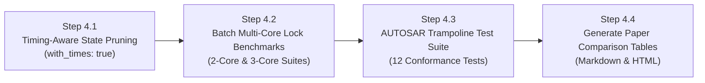
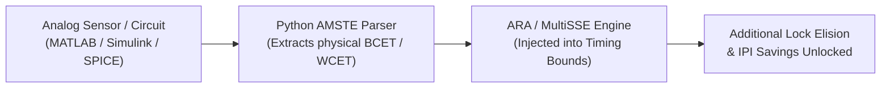

# 🧭 Beginner's Master Learning & Execution Roadmap
## *Mastering, Reproducing, and Extending Multi-Core AUTOSAR Static State Estimation (MultiSSE)*

> **Target Audience:** Complete beginners in Real-Time Operating Systems (RTOS), Compilers, and Static Code Analysis.  
> **Guiding Philosophy:** Plain English first, clear real-world analogies, zero unexplained jargon, and hands-on milestones.  
> **Reference Paper:** *Applied Static Analysis and Specialization of Cross-Core Syscalls for Multi-Core AUTOSAR OS* — Real-Time Systems, vol. 60, pp. 491–533, 2024 (Entrup et al.)

---

## 🗺️ High-Level Roadmap Overview

---

## 📘 Module 1: Foundational Concepts (Zero to Hero)

Before touching any code or terminal commands, you need a crystal-clear mental model of the problems we are solving.

### 1.1 What is an Automotive OS (AUTOSAR)?
* **Everyday Operating Systems (Windows, Android):** Optimized for human interaction, smooth scrolling, and multitasking. If an app stutters for 50 milliseconds, you barely notice.
* **Real-Time Operating Systems (AUTOSAR):** Installed inside cars (Electronic Control Units / ECUs). If the anti-lock braking (ABS) task is delayed by even 5 milliseconds, the car fails to stop in time. Timing correctness is a strict life-and-death requirement.
* **Partitioning:** High-criticality tasks (Braking, Steering) and lower-criticality tasks (Dashboard, Infotainment) are assigned to separate CPU cores so they cannot interfere with each other.

### 1.2 The Multi-Core Dilemma: Why Multi-Core is Hard
Modern automotive chips have multiple processor cores (e.g., Core 0 and Core 1).
1. **The Shared Data Problem:** What happens if Core 0 is calculating vehicle speed and writing it to memory, while Core 1 is reading vehicle speed to display on the dashboard? If both access that memory address at the same instant, data gets corrupted (a **Data Race**).
2. **The Traditional Fix — Spinlocks:** Programmers put a "lock" on the memory location. Core 0 locks the door, writes the data, and unlocks it. While locked, Core 1 sits in an active `while(locked)` loop burning processor cycles ("spinning").
3. **The Inter-Core Doorbell — IPIs (Inter-Processor Interrupts):** When Core 0 finishes a calculation and needs Core 1 to immediately start a task, Core 0 sends an electrical signal across the chip (an IPI). This forces Core 1 to stop what it's doing, save its registers, and switch tasks. This electrical doorbell ring burns over **1,800 clock cycles** every time it happens.

### 1.3 What is "Static Analysis"?
* **Dynamic Testing:** Running the car on a test track and watching what happens. You only see what happens on that specific test run; rare edge cases are easily missed.
* **Static Analysis:** Reading the source code like a blueprint or recipe book without executing it. A static analysis tool analyzes every single possible path the program could ever take in the future, proving properties mathematically with 100% certainty.

### 1.4 Plain English Glossary of Terms You Will See
| Term | Plain English Meaning | Analogy |
| :--- | :--- | :--- |
| **ABB** *(Atomic Basic Block)* | A chunk of code that runs from start to finish without pausing, ending in an OS call. | A single continuous stride when walking. |
| **MSTG** *(Multi-Core State Transition Graph)* | A complete map of every possible future timeline across all CPU cores simultaneously. | A "Choose Your Own Adventure" flowchart containing every possible storyline. |
| **SP** *(Synchronization Point)* | A boundary where one core must wait for, notify, or interact with another core. | A traffic light or intersection between two roads. |
| **Lock Elision** | Deleting a lock and turning it into a 0-cycle no-op because the map proves cores never collide. | Removing a stop sign at an intersection where only one car ever drives. |
| **IPI Avoidance** | Skipping the electrical doorbell ring because the target core is already scheduled to do the work. | Dropping mail in a mailbox quietly because you know the person is already standing by the door. |
| **OIL** *(OSEK Implementation Language)* | A configuration text file describing which tasks run on which cores, their priorities, and their alarms. | The organizational chart of an office. |

---

## 📄 Module 2: Decoding the Research Paper

### 2.1 The Core Scientific Breakthrough
If you try to map every possible combination of states across 4 cores, the total number of combinations is astronomical (State Explosion: $\mathcal{O}(N_1 \times N_2 \times N_3 \times N_4)$). A computer would run out of RAM and freeze.

**The Authors' Breakthrough:**  
MultiSSE explores each CPU core **independently**. It only links the cores together at **Synchronization Points (SPs)** where cross-core syscalls (`ActivateTask`, `GetSpinlock`) occur. This reduces state explosion from billions of states down to just dozens or hundreds.

### 2.2 Optimization #1: Spinlock Elision
* **The Rule:** If a spinlock `S1` is acquired by Task A on Core 0 and Task B on Core 1, but the timeline map proves that Task A and Task B never run at the same time, the spinlock can be completely deleted.
* **Paper Result:** Across **872 test automotive applications**, MultiSSE successfully **eliminated 65.7% of all spinlocks** (4,695 out of 7,143 locks removed).

### 2.3 Optimization #2: Inter-Processor Interrupt (IPI) Avoidance
* **The Rule:** When Core 0 activates a task on Core 1, if Core 1 is already running a higher-priority task, Core 1 cannot switch immediately anyway. Core 0 simply writes the task into Core 1's ready queue without sending an electrical IPI.
* **Paper Result:** Saved **1,140 hardware clock cycles** per avoided IPI (a 61.9% speedup).

---

## 🛠️ Module 3: Anatomy of Our Software Lab (What We Built)

To understand what is happening on your computer, here is how the software components fit together:

### 3.1 What We Discovered and Fixed in the Code
During our initial setup, the researchers' code had hidden bugs that caused analysis crashes. Here is what we found and fixed:
1. **The Missing Pointer Specs (`ExtAPI.json`):**  
   The pointer analysis library (SVF) crashed because a JSON definition file was missing after repository migration. We restored the file and configured automatic path discovery.
2. **The Dropped Spinlock Bug ([`autosar.py`](file:///home/mourya/projects/Major_Project/parrot/subprojects/ara/ara/os/autosar.py)):**  
   When MultiSSE merged per-core states into a global multi-core state, multi-core spinlocks were being filtered out because of an incorrect type check. We corrected this so spinlocks properly persist across all core transitions.
3. **Empty Predecessor Loop ([`pairing_partner_search.py`](file:///home/mourya/projects/Major_Project/parrot/subprojects/ara/ara/steps/multisse_helper/pairing_partner_search.py)):**  
   Fixed an edge-case stall when pairing cross-core actions with zero predecessor states.

---

## 🔬 Module 4: Completing the Software Replication (Where We Are Now)

We have already completed the foundation:
* ✅ Generated full MSTG on `minexample` (112 vertices, 759 edges, 59 SPs in 18s).
* ✅ Proved 100% Lock Elision on 2-core lock benchmark (`locks_2cores_a`).

Here are the remaining software replication tasks:

### Detailed Breakdown of Steps:
* **Step 4.1: Timing-Aware Pruning:**  
  * *What it is:* Right now, MultiSSE assumes any task can take any amount of time (0 to $\infty$). When we add real timing boundaries (Best-Case Execution Time / Worst-Case Execution Time), impossible timelines vanish.
  * *Expected Result:* The state graph shrinks by **~50%** (e.g., from ~112 to ~67 vertices).
* **Step 4.2: Full Lock Benchmark Suite:**  
  * *What it is:* Run MultiSSE across all 2-core and 3-core benchmark apps in `parrot/subprojects/ara/appl/AUTOSAR/multicore/locks/`.
  * *Expected Result:* Validate that MultiSSE reliably identifies all elidable locks across different task priorities and chain configurations.
* **Step 4.3: Trampoline Conformance Test Suite:**  
  * *What it is:* Run the official multi-core AUTOSAR test suite (`meson test -C build --suite multisse`) to verify all 12 OS conformance test cases pass.
* **Step 4.4: Final Reproduction Report:**  
  * Compile all metrics into side-by-side tables matching Table 1, Table 2, and Figure 5 of the published research paper.

---

## 🚀 Module 5: Phase 2 Extension — AMSTE (Our Major Project Novelty)

Replicating the paper gives us the 50% milestone. To achieve a top-grade Major Project, we must **extend** their research with our own novelty: **AMSTE (AUTOSAR Mixed-Signal Timing Extension)**.

### 5.1 The Core Research Idea
* **The Limitation in the Original Paper:** The original paper only measured pure software execution times on the CPU.
* **The Reality in Automotive ECUs:** Automotive software interacts with the physical world:
  * Analog RC low-pass filters on wheel speed sensors take time to charge ($RC$ settling time).
  * Analog-to-Digital Converters (ADCs) take clock cycles to sample and convert voltages.
  * PWM signals controlling fuel injectors or brushless DC motors have rise/fall delay times.
* **Our Contribution (AMSTE):** We model these **analog mixed-signal hardware delays** (using MATLAB, Simulink, or SPICE) and feed them directly into the MultiSSE timing engine. Because physical sensors take a minimum time to respond, we can prove even more CPU states are unreachable, allowing **even more spinlocks and IPIs to be eliminated**!

---

## 🔌 Module 6: Physical Hardware Validation (Raspberry Pi 4)

Once all software analyses are complete:
1. **Target Board:** Raspberry Pi 4 Model B (Quad-core ARM Cortex-A72).
2. **Deploying the Bare-Metal OS:** We compile the specialized AUTOSAR OS binary (with the unneeded locks and IPIs removed).
3. **Hardware Cycle Verification:** The OS reads the ARM CPU's Performance Monitoring Unit (`PMCCNTR_EL0`) directly on real hardware to measure the exact clock cycles saved.

---

## 📋 Recommended Action Plan & Your Sign-Off

Here is how we will proceed step-by-step:

1. **Review & Approval:** You read through this roadmap and ask any clarifying questions about the concepts.
2. **Execute Software Steps (Steps 4.1 – 4.4):** Upon your approval, we run the automated timing pruning and lock benchmark batch (total execution: ~10 minutes).
3. **Review Generated Tables & Dashboard:** We verify the complete data tables and visual charts together.
4. **Begin Phase 2 AMSTE Implementation:** We start designing the analog timing injection pipeline for your Major Project novelty.

> [!TIP]
> Click the **Proceed** button or let me know if you would like any section explained further before we begin!
